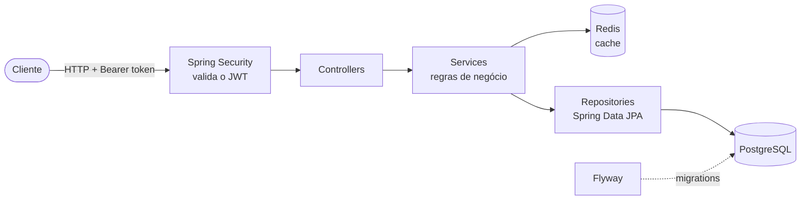
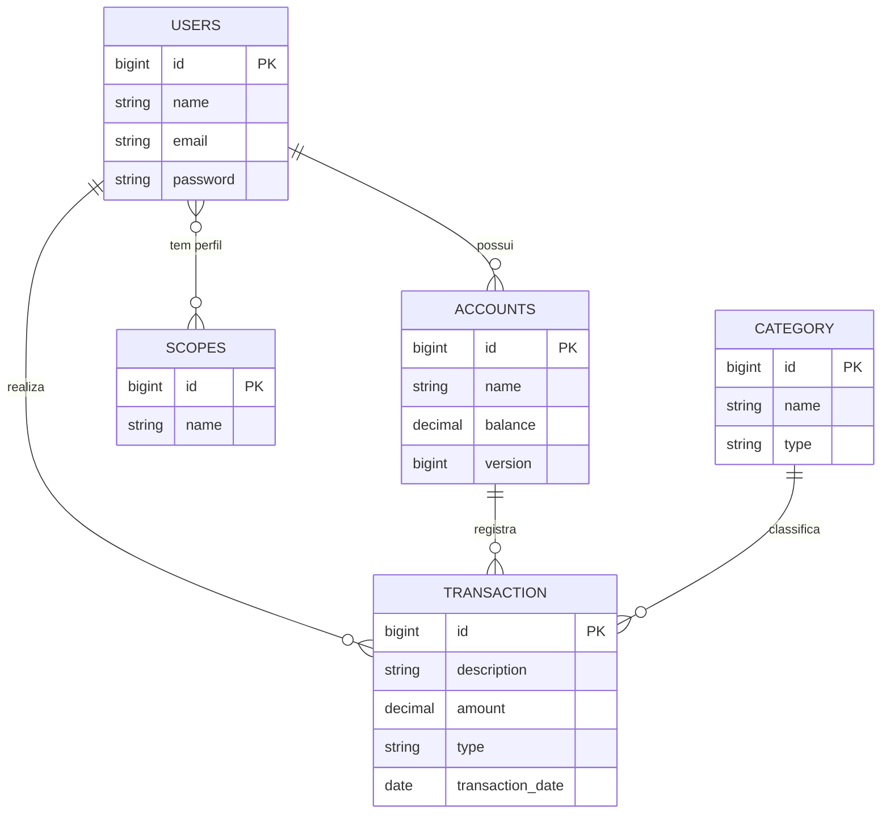

<div align="center">

# 💰 Controle Financeiro API

**API REST para controle financeiro pessoal, com saldo sempre consistente.**

Contas, categorias e transações por usuário, autenticação JWT e cache com Redis.


[Funcionalidades](#-funcionalidades) •
[Como rodar](#-como-rodar) •
[Endpoints](#-endpoints) •
[Arquitetura](#-arquitetura) •
[Roadmap](#-roadmap)

</div>

---

## ✨ Funcionalidades

- 🔐 **Autenticação JWT** com chaves RSA e controle de acesso por perfil (`Usuario` e `Admin`)
- 🏦 **Contas** por usuário, com criação, consulta, renomeação, exclusão e depósito
- 🧾 **Transações** de 6 tipos (receita, despesa, transferências, investimento e estorno)
- ⚖️ **Saldo consistente:** criar, editar ou apagar uma transação ajusta o saldo automaticamente, e o saldo nunca fica negativo
- 🗂️ **Categorias** padrão já criadas pelas migrations
- 🛡️ **Isolamento entre usuários:** cada pessoa enxerga e altera apenas os próprios dados
- ⚡ **Cache com Redis** nas listagens e consultas, com invalidação a cada alteração
- 🔄 **Concorrência segura** nas contas com controle otimista de versão
- 🐘 **Migrations versionadas** com Flyway
- 🐳 **Docker Compose** para subir tudo com um comando

## 🧰 Tecnologias

| Camada | Tecnologia |
|---|---|
| Linguagem | Java 17 |
| Framework | Spring Boot 4 (Web, Security, Data JPA, Validation, Cache) |
| Segurança | OAuth2 Resource Server, JWT assinado com RSA |
| Banco de dados | PostgreSQL 15 + Flyway |
| Cache | Redis |
| Mapeamento | MapStruct e Lombok |
| Build | Maven (wrapper incluído) |
| Infraestrutura | Docker e Docker Compose |

## 🏗️ Arquitetura



### Modelo de dados



### Estrutura do projeto

```
src/main/java/com/jm/controleFinanceiro/
├── config/         # Segurança (JWT, CORS), Redis e tratamento global de erros
├── controller/     # Endpoints REST, com request/ e response/ (DTOs)
├── enums/          # TransactionType
├── exceptions/     # Exceções de negócio
├── mapper/         # Conversão entidade <-> DTO (MapStruct)
├── model/          # Entidades JPA
├── repository/     # Repositórios Spring Data
└── service/        # Regras de negócio
src/main/resources/
├── application.yaml
└── db/migration/   # Migrations do Flyway
```

## 🚀 Como rodar

### Pré-requisitos

- Docker e Docker Compose
- OpenSSL (para gerar as chaves do JWT)
- JDK 17+ (somente para rodar a aplicação fora do Docker)

### 1. Clonar o repositório

```bash
git clone https://github.com/Jmarceloapolinario/controleFinanceiro.git
cd controleFinanceiro
```

### 2. Configurar as variáveis de ambiente

```bash
cp .env.example .env
```

Edite o `.env` e troque pelo menos `DB_PASSWORD`. O `docker compose` lê esse arquivo automaticamente.

### 3. Gerar as chaves do JWT

A API assina os tokens com uma chave privada RSA e os valida com a chave pública. Esses arquivos **não ficam no repositório** (`*.pem` e `*.pub` estão no `.gitignore`), então cada pessoa gera os seus:

```bash
# 1. Chave privada temporária
openssl genrsa -out app.key 2048

# 2. Chave pública (formato X.509)
openssl rsa -in app.key -pubout -out src/main/resources/authz.pub

# 3. Chave privada em PKCS#8 (formato que o Spring lê)
openssl pkcs8 -topk8 -inform PEM -outform PEM -nocrypt \
  -in app.key -out src/main/resources/authz.pem

# 4. Remove a chave temporária
rm app.key
```

> [!WARNING]
> Nunca faça commit dessas chaves e gere chaves novas para cada ambiente. Fora do desenvolvimento, aponte para chaves externas com `JWT_PUBLIC_KEY` e `JWT_PRIVATE_KEY` (por exemplo `file:/etc/secrets/authz.pem`).

### 4. Subir a aplicação

<details open>
<summary><b>Opção A: tudo no Docker (aplicação, Postgres e Redis)</b></summary>

```bash
docker compose up -d --build
```

As chaves precisam existir em `src/main/resources/` **antes** do build: o `Dockerfile` copia a pasta `src`, e as chaves ficam empacotadas no JAR da imagem. Por isso, não publique essa imagem em registros públicos.

</details>

<details>
<summary><b>Opção B: Postgres e Redis no Docker, aplicação local (bom para desenvolvimento)</b></summary>

```bash
docker compose up -d postgres redis

# Linux / macOS: exporta o .env para o processo da aplicação
set -a && source .env && set +a
./mvnw spring-boot:run
```

O Spring Boot **não lê o `.env` sozinho**. No Windows, defina as variáveis no terminal ou na configuração de execução da IDE. Se o `DB_PASSWORD` do `.env` for diferente do padrão da aplicação (`postgres`), ele precisa ser exportado, senão a conexão falha.

</details>

Nas duas opções, as migrations rodam na inicialização e a API fica em **http://localhost:8080** (porta alterável com `APP_PORT` na opção A).

### Variáveis de ambiente

| Variável | Padrão da aplicação | Descrição |
|---|---|---|
| `DB_HOST` | `localhost` | Host do PostgreSQL |
| `DB_PORT` | `5432` | Porta do PostgreSQL no host |
| `DB_NAME` | `controle_financeiro` | Nome do banco |
| `DB_USERNAME` | `postgres` | Usuário do banco |
| `DB_PASSWORD` | `postgres` | Senha do banco |
| `DB_DDL_AUTO` | `validate` | Modo do Hibernate |
| `DB_SHOW_SQL` | `true` | Exibe o SQL no log |
| `DB_FORMAT_SQL` | `true` | Formata o SQL do log |
| `REDIS_HOST` | `localhost` | Host do Redis |
| `REDIS_PORT` | `6379` | Porta do Redis |
| `REDIS_PASSWORD` | vazio | Senha do Redis |
| `FLYWAY_ENABLED` | `true` | Habilita as migrations |
| `JWT_PUBLIC_KEY` | `classpath:authz.pub` | Localização da chave pública |
| `JWT_PRIVATE_KEY` | `classpath:authz.pem` | Localização da chave privada |
| `APP_PORT` | `8080` | Porta da API (somente no `docker compose`) |

## 🔑 Autenticação

1. Cadastre um usuário em `POST /users`.
2. Faça login em `POST /login` e copie o `accessToken`.
3. Envie o token nas demais requisições: `Authorization: Bearer <token>`.

O token expira em 10 minutos (`expiresIn: 600`). Depois disso, faça login novamente.

## 📡 Endpoints

Todos exigem token, exceto `POST /users` e `POST /login`.

| Método | Rota | Descrição | Acesso |
|---|---|---|---|
| `POST` | `/users` | Cadastra um usuário | Público |
| `POST` | `/login` | Autentica e retorna o token | Público |
| `POST` | `/account` | Cria uma conta | Autenticado |
| `GET` | `/account` | Lista as contas do usuário (paginado) | Autenticado |
| `GET` | `/account/{id}` | Busca uma conta | Autenticado |
| `PUT` | `/account/{id}` | Renomeia a conta | Autenticado |
| `DELETE` | `/account/{id}` | Apaga a conta **e suas transações** | Autenticado |
| `POST` | `/account/deposit/{id}` | Deposita um valor na conta | Autenticado |
| `POST` | `/transaction` | Registra uma transação e atualiza o saldo | Autenticado |
| `GET` | `/transaction` | Lista as transações do usuário (paginado) | Autenticado |
| `GET` | `/transaction/{id}` | Busca uma transação | Autenticado |
| `PUT` | `/transaction/{id}` | Edita descrição, valor e tipo (ajusta o saldo) | Autenticado |
| `DELETE` | `/transaction/{id}` | Apaga a transação e desfaz o efeito no saldo | Autenticado |
| `POST` | `/category` | Cria uma categoria | 🛡️ Admin |
| `GET` | `/category` | Lista as categorias (paginado) | Autenticado |
| `GET` | `/category/{id}` | Busca uma categoria | Autenticado |

A paginação usa os parâmetros padrão do Spring: `?page=0&size=10&sort=id,desc`.

<details>
<summary><b>Corpos das requisições</b></summary>

| Rota | Corpo (JSON) |
|---|---|
| `POST /users` | `{"name", "email", "password"}` |
| `POST /login` | `{"email", "password"}` |
| `POST /account` | `{"name", "balance"}` |
| `PUT /account/{id}` | `{"name"}` |
| `POST /account/deposit/{id}` | `{"amount"}` (maior que zero) |
| `POST /transaction` e `PUT /transaction/{id}` | `{"description", "amount", "type", "transactionDate", "accountId", "categoryId"}` |
| `POST /category` | `{"name", "type"}` |

`transactionDate` usa o formato `AAAA-MM-DD`.

</details>

### ⚖️ Regras de saldo

| Tipo de transação | Efeito no saldo |
|---|---|
| `INCOME` | ➕ Soma |
| `TRANSFER_IN` | ➕ Soma |
| `REFUND` | ➕ Soma |
| `EXPENSE` | ➖ Subtrai |
| `TRANSFER_OUT` | ➖ Subtrai |
| `INVESTMENT` | ➖ Subtrai |

- O saldo só muda por **transação** ou **depósito**. O `PUT /account/{id}` altera apenas o nome.
- Ao **editar** uma transação, a API desfaz o efeito antigo e aplica o novo, então mudar valor ou tipo mantém o saldo correto.
- Ao **apagar** uma transação, o efeito dela é revertido.
- Se uma operação deixaria o saldo abaixo de zero (despesa, edição ou exclusão de uma receita), a API responde `400` com `Insufficient balance in the account`.

## 🧪 Exemplo de uso

<details open>
<summary><b>Fluxo completo com curl</b></summary>

```bash
# 1. Criar usuário
curl -X POST http://localhost:8080/users \
  -H "Content-Type: application/json" \
  -d '{"name":"Maria","email":"maria@email.com","password":"senha123"}'

# 2. Login (copie o accessToken da resposta)
curl -X POST http://localhost:8080/login \
  -H "Content-Type: application/json" \
  -d '{"email":"maria@email.com","password":"senha123"}'

TOKEN="cole_o_token_aqui"

# 3. Criar uma conta com saldo inicial de 1000
curl -X POST http://localhost:8080/account \
  -H "Authorization: Bearer $TOKEN" \
  -H "Content-Type: application/json" \
  -d '{"name":"Conta Corrente","balance":1000.00}'

# 4. Listar categorias (para pegar o categoryId)
curl http://localhost:8080/category -H "Authorization: Bearer $TOKEN"

# 5. Registrar uma despesa (saldo: 1000 -> 849.50)
curl -X POST http://localhost:8080/transaction \
  -H "Authorization: Bearer $TOKEN" \
  -H "Content-Type: application/json" \
  -d '{
    "description": "Supermercado",
    "amount": 150.50,
    "type": "EXPENSE",
    "transactionDate": "2026-11-21",
    "accountId": 1,
    "categoryId": 1
  }'

# 6. Depositar na conta
curl -X POST http://localhost:8080/account/deposit/1 \
  -H "Authorization: Bearer $TOKEN" \
  -H "Content-Type: application/json" \
  -d '{"amount": 200.00}'

# 7. Apagar a transação (o saldo volta)
curl -X DELETE http://localhost:8080/transaction/1 \
  -H "Authorization: Bearer $TOKEN"
```

</details>

## 👥 Perfis de acesso

Todo usuário cadastrado recebe o perfil `Usuario`. Somente o perfil `Admin` cria categorias. Não existe endpoint para promover usuários, então o primeiro administrador é criado direto no banco:

```sql
INSERT INTO users_scopes (user_id, scope_id)
SELECT u.id, s.id
FROM users u, scopes s
WHERE u.email = 'maria@email.com' AND s.name = 'Admin';
```

Depois, faça login novamente para receber um token com o novo perfil.

## 🗂️ Categorias padrão

| Despesas | Receitas |
|---|---|
| Alimentação | Salário |
| Moradia | Investimentos |
| Transporte | Deposito |
| Saúde | Freelance |
| Educação | |
| Lazer | |

O endpoint de depósito registra a movimentação na categoria `Deposito`.

## ⚠️ Limitações conhecidas

- `PUT /transaction/{id}` atualiza descrição, valor e tipo. `accountId`, `categoryId` e `transactionDate` enviados no corpo ainda são ignorados na edição.
- Apagar uma conta apaga também todas as transações dela.
- Ainda não há testes automatizados além de `contextLoads`.

## 🗺️ Roadmap

- [x] Autenticação JWT com perfis
- [x] CRUD de contas e transações com saldo consistente
- [x] Cache com Redis
- [x] Docker Compose
- [ ] Testes de integração (Testcontainers)
- [ ] Editar categoria, conta e data da transação
- [ ] Excluir categorias
- [ ] Filtros por período, categoria e tipo
- [ ] Relatórios (resumo mensal e gastos por categoria)
- [ ] Transferência entre contas
- [ ] Documentação OpenAPI/Swagger
- [ ] Pipeline de CI (GitHub Actions)

## 📄 Licença

Defina a licença do projeto (por exemplo MIT) e adicione um arquivo `LICENSE`.

---

<div align="center">

Feito por [Jmarceloapolinario](https://github.com/Jmarceloapolinario) · Se o projeto ajudou, deixe uma ⭐

</div>
